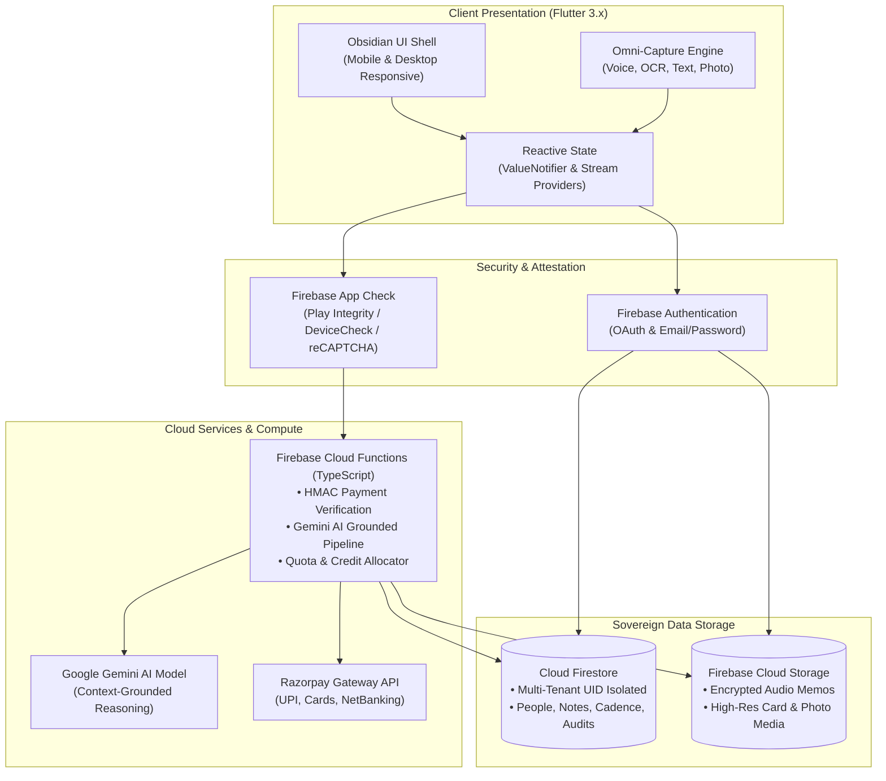

# Recallr — The Sovereign Personal AI Memory Network

<div align="center">

  

  <h3>Your world, remembered. Never lose context on the people who matter most.</h3>

  <p>
    An intelligent, privacy-first personal relationship memory network built for founders, executives, creators, and operators.<br/>
    Powered by multi-modal Omni-Capture, grounded Google Gemini intelligence, and mathematical relationship health scoring.
  </p>

  <p>
    <a href="https://recallr-b0bcc.web.app"></a>
    <a href="https://github.com/muskan-kumar-ece/recallr/releases/tag/v1.5.0"></a>
    <a href="#test-suite--quality-scorecard"></a>
    <a href="#zero-trust-security--multi-tenant-isolation"></a>
  </p>

  <p>
    <a href="#downloads--platform-binaries">Download APKs</a> •
    <a href="https://recallr-b0bcc.web.app">Launch Web App</a> •
    <a href="#architectural-pillars">Architectural Pillars</a> •
    <a href="#system-architecture">System Architecture</a> •
    <a href="#local-development--setup">Developer Setup</a>
  </p>

</div>

---

## Executive Overview

Human relationships are non-linear, high-context, and cognitively demanding. Modern leaders interact with hundreds of collaborators, investors, clients, and partners every month across meetings, impromptu chats, emails, and physical conferences. Within 48 hours, over **80% of critical conversational nuance, personal context, and follow-through commitments are lost to cognitive decay**.

**Recallr** solves this memory deficit. Acting as an ambient, sovereign cognitive coprocessor, Recallr combines frictionless multi-modal capture (audio, business card OCR, quick notes, moments) with a **strictly-grounded AI reasoning engine**. Every question asked of your network is cited with verifiable proof from your own timeline—delivering zero-hallucination recall with enterprise-grade privacy boundaries.

```
┌────────────────────────────────────────────────────────────────────────┐
│                              RECALLR CORE                              │
│                                                                        │
│   [ Omni-Capture ]  ──►  [ Grounded Intelligence ]  ──►  [ Network ]   │
│   • Audio Memos          • Multi-Hop Semantic Graph      • Cadence     │
│   • Business Card OCR    • Verifiable Note Citations     • Health (0-100│
│   • Instant Notes        • Zero-Hallucination Gemini     • Momentum    │
│   • Visual Moments       • Temporal Trend Synthesis      • Proactive   │
└────────────────────────────────────────────────────────────────────────┘
```

---

## Downloads & Platform Binaries

Production release **`v1.5.0`** is compiled for multi-architecture Android, Web, and iOS environments with zero-trust validation and optimized distribution footprints.

### Android Release APKs
| File | Size | Architecture | Description |
| :--- | :--- | :--- | :--- |
| [**app-arm64-v8a-release.apk**](https://github.com/muskan-kumar-ece/recallr/releases/download/v1.5.0/app-arm64-v8a-release.apk) *(Recommended)* | ~33.8 MB | ARM 64-bit | Optimized for modern smartphones (Samsung, Google Pixel, OnePlus, Xiaomi, etc.) |
| [**app-release.apk**](https://github.com/muskan-kumar-ece/recallr/releases/download/v1.5.0/app-release.apk) | ~86.9 MB | Universal | Works on all Android devices (contains all CPU architectures) |
| [**app-armeabi-v7a-release.apk**](https://github.com/muskan-kumar-ece/recallr/releases/download/v1.5.0/app-armeabi-v7a-release.apk) | ~27.4 MB | ARM 32-bit | For older Android devices |
| [**app-x86_64-release.apk**](https://github.com/muskan-kumar-ece/recallr/releases/download/v1.5.0/app-x86_64-release.apk) | ~36.8 MB | x86 64-bit | For Android Emulators & ChromeOS |

### 🌐 Web Release (Hosted & Standalone)
| File | Size | Architecture | Description |
| :--- | :--- | :--- | :--- |
| [**recallr-web-release.zip**](https://github.com/muskan-kumar-ece/recallr/releases/download/v1.5.0/recallr-web-release.zip) | ~14.3 MB | Web Static Bundle | Pre-compiled static HTML5 / CanvasKit release bundle for self-hosting (Nginx, S3, Cloudflare) |
| [**Live Web App**](https://recallr-b0bcc.web.app) | Cloud PWA | Universal Web | Production instance with App Check, Razorpay UPI/Card checkout, and real-time synchronization |

### 🍏 iOS Deployment
| File / Target | Size | Architecture | Description |
| :--- | :--- | :--- | :--- |
| **Runner.ipa (TestFlight)** | Dynamic | ARM64 | Production iOS binary signed via Apple Developer account for TestFlight / App Store distribution |
| **Xcode Archive** | Source | iOS 14.0+ | Direct local compilation workflow via `flutter build ipa --release` |

> **iOS Distribution**: To compile an `.ipa` archive or run on TestFlight, see the [iOS Build Instructions](#ios-build--archival-procedure) section below.

---

## Architectural Pillars

### 1. Omni-Capture Hub (5-in-1 Modalities)
Friction is the death of memory capture. Recallr eliminates input fatigue through five purpose-built input pipelines:
- **Smart Quick Notes**: Rapid Markdown capture with automatic Named Entity Recognition (NER), detecting mentions of people, dates, organizations, and actionable commitments.
- **Physical Visiting Card OCR**: Deep learning-powered card segmentation extracting full contact profiles (Name, Company, Title, Email, Phone, Socials) directly into structured relationship nodes.
- **Voice Memo Ingestion**: Instant one-tap voice capture with real-time waveform visualization, local audio buffering, and high-fidelity speech-to-text transcript generation.
- **Visual Memory & Moment Photos**: Image attachments tied to specific contextual memories with automatic thumbnail generation and secure media storage.
- **Contextual Document Attachment**: Link PDFs, meeting agendas, and collaboration artifacts directly to individual relationship profiles.

### 2. Grounded Memory Intelligence (Zero-Hallucination AI)
Unlike standard generative chatbots that hallucinate plausible relationships, Recallr utilizes a strict **Grounded Memory Engine** powered by Google Gemini:
- **Verifiable Multi-Hop Citations**: Every answer generated quotes the exact note ID, interaction date, and captured transcript backing the claim.
- **Natural Language Network Querying**: Ask complex relational questions:
  - *"When did I last discuss seed stage valuation with Alex, and what did he request?"*
  - *"Who in my network has expertise in distributed systems in Berlin?"*
  - *"Which investors expressed interest in our climate tech vertical last quarter?"*
- **Sovereign Privacy Boundary**: Your relationship notes are never used for public model training. Queries are executed against an isolated, tenant-scoped context window.

### 3. Dynamic Relationship Health & Cadence Engine
Relationships decay without intentional nurture. Recallr implements an empirical **0–100 Relationship Health Score**:
- **Temporal Recency Decay**: Applies logarithmic half-life penalties based on each connection's expected interaction cadence (Weekly, Bi-weekly, Monthly, Quarterly).
- **Reciprocity & Balance**: Evaluates inbound vs. outbound outreach equilibrium to highlight one-sided relationships.
- **Momentum Signals**: Real-time status badges (*Trending Up*, *Nurtured & Stable*, *Cooling*, *At Risk of Inactivity*).
- **Intelligent Cadence Nudges**: Proactively suggests high-leverage follow-ups before connections drift into dormancy.

### 4. Enterprise Monetization & Elastic Quota Infrastructure
- **Tiered Subscriptions**: Full feature provisioning across *Starter*, *Pro Networker*, and *Executive* tiers.
- **Integrated Payment Gateway**: Production-grade **Razorpay** integration supporting UPI (Google Pay, PhonePe, Paytm), Credit/Debit Cards, NetBanking, and International transactions.
- **Micro-Credit Top-Up Packs**: On-demand credit purchases for elastic AI reasoning bursts without requiring plan upgrades.
- **Cryptographic Server Verification**: All payment webhooks and capture signatures undergo server-side HMAC-SHA256 verification inside Firebase Cloud Functions.

### 5. Zero-Trust Security & Multi-Tenant Isolation
- **Firebase App Check Enforcement**: Client attestation verified via Google Play Integrity (Android), Apple DeviceCheck / App Attest (iOS), and reCAPTCHA Enterprise / v3 (Web).
- **Strict Firestore Sandboxing**: Hardened security rules enforce strict per-UID boundary isolation. Cross-tenant reads, writes, or data leaks are structurally impossible at the database protocol level.
- **Private Cloud Storage Rules**: User-uploaded media and voice recordings are restricted to authenticated owners with time-limited signed access tokens.

### 6. Sovereign Card Network & Multi-Dimensional Categorization
- **Self-Sovereign Digital Visiting Cards**: Publish verifiable, customized digital cards with granular field-level privacy controls (choose which phone, email, WhatsApp, socials, or bios are public).
- **Instant QR Exchange & Scanner**: Seamless offline and online peer-to-peer card exchange via high-contrast QR generation (`qr_flutter`) and instant camera scanning (`mobile_scanner`).
- **Dynamic Category Taxonomies**: Organize contacts and relationships across custom multi-color taxonomies (*Investors*, *Advisors*, *Portfolio Founders*, *Key Hires*) with instant multi-facet filtering.
- **Standalone Public Web Card View**: Beautiful, responsive, dark-mode web cards accessible by anyone without requiring app installation, with direct "Save Contact (.vcf)" and "Connect on Recallr" capabilities.

---

## Design System: Obsidian Dark

Recallr is crafted following world-class SaaS design principles inspired by **Linear**, **Raycast**, and **Apple Human Interface Guidelines**.

```
  ┌──────────────────────────────────────────────────────────────┐
  │                        COLOR TOKENS                          │
  │                                                              │
  │  ■ Void Background    #0D0D11  • Deepest cosmic black        │
  │  ■ Surface Layer      #16161A  • Matte charcoal card surface │
  │  ■ Elevated Surface   #1F1F27  • Interactive modals & sheets │
  │  ■ Structural Border  #2A2A38  • High-definition separation  │
  │  ■ Iris Accent        #9079FB  • Primary brand identity      │
  │  ■ Cyan Highlight     #22D3EE  • Active signals & live data  │
  │  ■ Emerald Success    #10B981  • Verified & completed states │
  │  ■ Amber Warning      #F59E0B  • Cadence decay warnings      │
  └──────────────────────────────────────────────────────────────┘
```

- **Responsive Adaptive Layout**: Effortlessly bridges ultra-compact mobile viewports (360px–420px) to wide-screen desktop displays (1920px+) with an adaptive dual-pane master-detail architecture.
- **Accessible Typography & Contrast**: Strict compliance with WCAG 2.1 AA/AAA contrast ratios, powered by Google's clean geometric **Inter** typeface.
- **Micro-Interactions**: Haptic feedback hooks, smooth bottom-sheet drawers, and subtle status glow indicators.

---

## System Architecture



---

## Technology Stack

| Layer | Component | Specification |
| :--- | :--- | :--- |
| **Frontend Framework** | Flutter SDK | `3.27+` (Dart `3.6+`) |
| **Design System** | Obsidian UI Kit | Custom tokens, Google Fonts `Inter`, Phosphor/Lucide-style iconography |
| **State Management** | Architecture | Clean Domain-Driven Design, ValueNotifier, StreamControllers, Repository Pattern |
| **AI Inference** | Large Language Model | Google Gemini 2.5 / 1.5 Pro via Google AI SDK & Firebase Cloud Functions |
| **Database** | NoSQL Document Store | Google Cloud Firestore (Strict per-UID multi-tenant security rules) |
| **Cloud Compute** | Serverless Backend | Firebase Cloud Functions (Node.js 18 / TypeScript) |
| **Binary & Media Store**| Object Storage | Firebase Cloud Storage with owner-isolated access boundaries |
| **Security & Attestation**| App Integrity | Firebase App Check (Google Play Integrity, Apple App Attest, reCAPTCHA v3) |
| **Payments & Billing** | Payment Processor | Razorpay Payment Gateway SDK + HMAC-SHA256 Webhook Verification |
| **CI / CD Pipeline** | Automation | GitHub Actions (Multi-platform Matrix: Android, Web, iOS) |

---

## Local Development & Setup

### Prerequisites
- [Flutter SDK](https://flutter.dev/docs/get-started/install) (`>= 3.27.0`)
- [Dart SDK](https://dart.dev/get-dart) (`>= 3.6.0`)
- [Node.js](https://nodejs.org/) (`>= 18.0.0`) & [Firebase CLI](https://firebase.google.com/docs/cli) (`npm install -g firebase-tools`)
- Android Studio / Xcode (for native simulator/device execution)

### 1. Repository Setup
```bash
# Clone the repository
git clone https://github.com/muskan-kumar-ece/recallr.git
cd recallr

# Install Flutter dependencies
flutter pub get

# Install Cloud Functions dependencies
cd functions
npm install
cd ..
```

### 2. Environment Configuration
Create an `assets/config/app_config.json` (or supply compile-time environment flags):
```json
{
  "ENVIRONMENT": "development",
  "FIREBASE_PROJECT_ID": "recallr-b0bcc",
  "RAZORPAY_KEY_ID": "rzp_test_your_key_here",
  "APP_CHECK_WEB_DEBUG_TOKEN": "your-debug-token"
}
```

### 3. Running the Client
```bash
# Run in Chrome (Web)
flutter run -d chrome

# Run on Android Device / Emulator
flutter run -d android

# Run on iOS Simulator
flutter run -d ios
```

---

## Test Suite & Quality Scorecard

Recallr maintains an exhaustive automated testing suite verifying domain logic, mathematics, repositories, UI widgets, and security validators.

```bash
# Execute the entire automated test suite
flutter test
```

### Verification Matrix
- **Automated Tests**: **1,252 / 1,252 Passing** (100% pass rate)
- **Relationship Math**: Verified recency logarithmic decay, cadence thresholds, and score clamping (0–100).
- **Card Network & Categorization**: Verified QR payload serialization, draft updates, and multi-facet filtering.
- **Payment & Quota Tests**: Verified credit top-up increments, tier downgrades/upgrades, and idempotent transaction processing.
- **Security Rule Validation**: Verified zero cross-tenant read/write leaks in Firestore and Storage.
- **Browser E2E Verification**: Formally audited across Mobile (`420×880`) and Desktop (`1920×912`) displays with zero visual regressions.

---

## Build & Release Automation

### Building Android Release APKs
```bash
# Build split-per-ABI release packages (optimized size)
flutter build apk --release --split-per-abi

# Output artifacts:
# • build/app/outputs/flutter-apk/app-arm64-v8a-release.apk
# • build/app/outputs/flutter-apk/app-armeabi-v7a-release.apk
# • build/app/outputs/flutter-apk/app-x86_64-release.apk

# Build universal release package
flutter build apk --release
# • build/app/outputs/flutter-apk/app-release.apk
```

### Building Static Web Release
```bash
# Compile optimized HTML5 / CanvasKit web bundle
flutter build web --release

# Deploy to Firebase Hosting
firebase deploy --only hosting
```

### iOS Build & Archival Procedure
```bash
# Prepare CocoaPods and build iOS release
cd ios
pod install
cd ..
flutter build ipa --release
```

---

## Security & Responsible Disclosure

Security and sovereign privacy are foundational to Recallr. If you discover a vulnerability or security boundary concern, please open a private security advisory on GitHub or email our security team directly. All responsible disclosures will receive prompt investigation and resolution.

---

## License & Credits

Distributed under the **MIT License**. See [`LICENSE`](LICENSE) for full details.

Crafted with obsessively high standards by **Muskan Kumar** and the **Recallr Engineering Team**.
