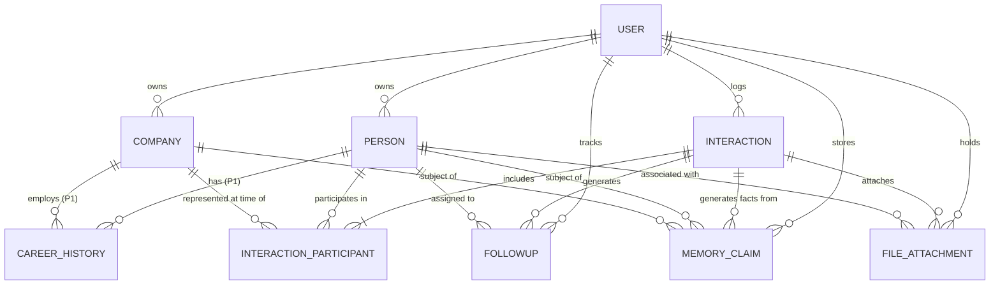

# Recallr — Phase 01 Data & Memory Architecture v1
**System Blueprint: AI Personal Network Memory**

*Document Status:* **READY FOR FINAL LOCK**  
*Version:* `1.1.0` (Targeted Correction & Hardening Pass)  
*Target Stack:* Flutter (iOS, Android, Web) + Cloud Firestore + Firebase Authentication + Firebase Storage + Firebase AI Logic / Cloud Functions  

---

## 1. Architecture Principles

Recallr is **not a CRM** and **not a basic address book**. It is an **AI Personal Network Memory** engine.

```
       ┌─────────────────────────────────────────────────────────┐
       │                       RECALLR LOOP                      │
       │                                                         │
       │   [Capture]  ──>  [Understand] ──> [Remember]           │
       │      │                                  │               │
       │      ▼                                  ▼               │
       │   [Connect]  <─────────────────────── [Ask]             │
       └─────────────────────────────────────────────────────────┘
```

1. **User-Owned Ground Truth over AI Speculation:**  
   User-authored source notes, voice transcripts, and files are immutable ground truth. AI-derived insights represent structured hypotheses that strictly link to verifiable source provenance.
2. **Professional Relationship as the Fundamental Object:**  
   The core atomic element is a multi-dimensional relationship memory containing people, organizations, interactions, commitments, files, and contextual claims.
3. **Temporal Integrity (History Preservation):**  
   Career moves, company changes, and evolving roles never overwrite or invalidate historic interactions. When Person A transitions from Company X to Company Y, historic meetings remain locked to their historical corporate context.
4. **Zero-Trust Multi-Tenant Isolation:**  
   Every byte of network memory is private to the user. All Firestore paths, storage buckets, and query scopes are anchored under `users/{userId}/*` with granular field-level security validation.
5. **Pragmatic V1 Offline-First Sync:**  
   Rely on native Cloud Firestore offline persistence (SQLite on mobile, IndexedDB on web) for all structured data. Introduce custom durable queues only where strictly necessary (media file uploads and background AI audio processing).
6. **Minimizing Hallucination through Grounded Retrieval:**  
   Natural language querying ("Ask Your Network") is anchored on retrieved user-owned memory claims with provenance, verification flags, citations, and explicit model abstention when context is absent.

---

## 2. Implementation Priority & Staging (P0 / P1 / P2)

To ensure rapid, non-over-engineered Phase 01 execution, domain entities and features are categorized into explicit implementation tiers:

```
┌─────────────────────────────────────────────────────────────────────────────────────────┐
│                           RECALLR IMPLEMENTATION TIERS                                  │
├──────────────────────────┬─────────────────────────────┬────────────────────────────────┤
│       P0: CORE V1        │        P1: NEXT V1.X        │       P2: FUTURE PHASES        │
│   (Essential Memory)     │     (Rich Context)          │     (Advanced Intelligence)    │
├──────────────────────────┼─────────────────────────────┼────────────────────────────────┤
│ • User (Tenant Root)     │ • CareerHistory             │ • ConnectionEdge (Graph)       │
│ • Person (Contacts)      │ • Event (Conferences/Expos) │ • Advanced Semantic Vector DB  │
│ • Company (Orgs/Vendors) │ • Location (Venues/Geopoint)│ • On-Device Embeddings         │
│ • Interaction (Meetings) │ • Conversation (Audio/STT)  │ • Opportunity Intelligence     │
│ • FollowUp (Commitments) │ • Tag / Taxonomy Tree       │ • Multilingual Memory Engine   │
│ • MemoryClaim (Facts/AI) │                             │ • Autonomous Network Outreach  │
│ • FileAttachment (Media) │                             │                                │
└──────────────────────────┴─────────────────────────────┴────────────────────────────────┘
```

* **P0 (Core V1 — Must Ship First):** Full single-user memory loop (Add person, assign company, log interaction notes, capture promises/follow-ups, extract & verify atomic memory claims, attach visiting cards/files).
* **P1 (Next V1.x):** Historic career progression tracking, event/expo association, location tagging, raw audio conversation transcription.
* **P2 (Future Phases):** Social graph edge traversal, dedicated vector database infrastructure, on-device embedding inference, automated opportunity discovery.
---

## 3. Domain Model & Entity Catalogue

### 3.1 `User` [P0 Core]
* **Purpose:** Represents the authenticated account holder and data owner.
* **Fields:**
  * `id` (`String`, Required, Immutable) — Firebase Auth UID.
  * `email` (`String`, Required, Mutable) — Account email.
  * `displayName` (`String`, Optional, Mutable) — User's name.
  * `photoUrl` (`String`, Optional, Mutable) — Avatar URL.
  * `preferences` (`Map<String, dynamic>`, Optional, Mutable) — User settings.
  * `createdAt` (`Timestamp`, Required, Immutable) — Account creation time.
  * `updatedAt` (`Timestamp`, Required, Mutable) — Last profile update.
* **Ownership:** Root Tenant (`users/{userId}`).
* **Origin:** User-authored.

### 3.2 `Person` [P0 Core]
* **Purpose:** A professional contact in the user's personal network.
* **Fields:**
  * `id` (`String`, Required, Immutable) — Auto-generated document ID.
  * `userId` (`String`, Required, Immutable) — Owner UID.
  * `displayName` (`String`, Required, Mutable) — Full contact name.
  * `firstName` (`String`, Optional, Mutable) — First name for prefix search.
  * `lastName` (`String`, Optional, Mutable) — Last name.
  * `avatarUrl` (`String`, Optional, Mutable) — Profile picture or card photo.
  * `emails` (`List<String>`, Optional, Mutable) — Contact emails.
  * `phones` (`List<String>`, Optional, Mutable) — Phone numbers.
  * `linkedinUrl` (`String`, Optional, Mutable) — LinkedIn profile URL.
  * `currentCompanyId` (`String`, Optional, Mutable) — Reference to active `Company`.
  * `currentCompanyName` (`String`, Optional, Mutable) — *Denormalized* for instant rendering.
  * `currentRole` (`String`, Optional, Mutable) — *Denormalized* active title (e.g., "VP Hardware").
  * `topCapabilities` (`List<String>`, Optional, Mutable) — *Denormalized* top capabilities.
  * `tags` (`List<String>`, Optional, Mutable) — Categorization tags (e.g., `["pcb", "investor"]`).
  * `howMetSummary` (`String`, Optional, Mutable) — Narrative summary of how they entered the network.
  * `lastInteractionAt` (`Timestamp`, Optional, Mutable) — *Denormalized* timestamp of most recent touchpoint.
  * `unreadFollowUpsCount` (`int`, Required, Mutable, Default: 0) — Active pending tasks count.
  * `isDeleted` (`bool`, Required, Mutable, Default: false) — Soft delete marker.
  * `deletedAt` (`Timestamp`, Optional, Mutable) — Soft deletion timestamp.
  * `createdAt` (`Timestamp`, Required, Immutable) — Server creation timestamp.
  * `updatedAt` (`Timestamp`, Required, Mutable) — Server update timestamp.
* **Ownership:** `users/{userId}/people/{personId}`.
* **Origin:** Hybrid (User-created or extracted via Business Card OCR / Meeting notes).

### 3.3 `Company` [P0 Core]
* **Purpose:** Organizations, manufacturers, agencies, and enterprises represented by people.
* **Fields:**
  * `id` (`String`, Required, Immutable) — Document ID.
  * `userId` (`String`, Required, Immutable) — Owner UID.
  * `name` (`String`, Required, Mutable) — Organization legal or brand name.
  * `domain` (`String`, Optional, Mutable) — Web domain (e.g., `apexcircuits.com`).
  * `industry` (`String`, Optional, Mutable) — Industry taxonomy.
  * `specialties` (`List<String>`, Optional, Mutable) — Business capabilities.
  * `headquartersLocation` (`String`, Optional, Mutable) — City / Country.
  * `isDeleted` (`bool`, Required, Mutable, Default: false) — Soft delete marker.
  * `createdAt` (`Timestamp`, Required, Immutable).
  * `updatedAt` (`Timestamp`, Required, Mutable).
* **Ownership:** `users/{userId}/companies/{companyId}`.
* **Origin:** Hybrid.

### 3.4 `Interaction` [P0 Core]
* **Purpose:** An atomic meeting, phone call, casual coffee, email exchange, or booth discussion.
* **Fields:**
  * `id` (`String`, Required, Immutable) — Document ID.
  * `userId` (`String`, Required, Immutable) — Owner UID.
  * `type` (`String`, Required, Mutable) — Enum: `meeting`, `call`, `email`, `chat`, `conference_booth`, `spontaneous`.
  * `occurredAt` (`Timestamp`, Required, Mutable) — When the interaction took place.
  * `locationName` (`String`, Optional, Mutable) — Plaintext venue or city name.
  * `locationId` (`String`, Optional, Mutable) — Reference to `Location` [P1].
  * `eventId` (`String`, Optional, Mutable) — Reference to `Event` [P1].
  * `eventName` (`String`, Optional, Mutable) — Denormalized event name.
  * `participants` (`List<Map<String, dynamic>>`, Required, Mutable) — Array of:
    * `personId` (`String`, Required)
    * `personName` (`String`, Required)
    * `representedCompanyId` (`String`, Optional) — **Locks historic company context at time of meeting**.
    * `representedCompanyName` (`String`, Optional)
    * `roleAtTime` (`String`, Optional)
  * `userNotes` (`String`, Optional, Mutable) — **Immutable Ground Truth**: Raw, unedited user notes/bullets.
  * `aiSummary` (`String`, Optional, Mutable) — AI-synthesized recap.
  * `keyTakeaways` (`List<String>`, Optional, Mutable) — Bullet points extracted by AI.
  * `fileIds` (`List<String>`, Optional, Mutable) — Attached files/photos.
  * `isDeleted` (`bool`, Required, Mutable, Default: false).
  * `createdAt` (`Timestamp`, Required, Immutable).
  * `updatedAt` (`Timestamp`, Required, Mutable).
* **Ownership:** `users/{userId}/interactions/{interactionId}`.
* **Origin:** Hybrid (User logs event; AI generates summaries & parses attendees).

### 3.5 `FollowUp` [P0 Core]
* **Purpose:** Track promises and commitments made by either party with deadlines.
* **Fields:**
  * `id` (`String`, Required, Immutable).
  * `userId` (`String`, Required, Immutable).
  * `personId` (`String`, Required, Mutable) — Associated person.
  * `personName` (`String`, Required, Mutable) — Denormalized name.
  * `interactionId` (`String`, Optional, Mutable) — Source interaction.
  * `direction` (`String`, Required, Mutable) — Enum: `i_promised`, `they_promised`, `mutual`.
  * `taskDescription` (`String`, Required, Mutable) — Actionable description.
  * `dueDate` (`Timestamp`, Optional, Mutable) — Deadline.
  * `status` (`String`, Required, Mutable) — Enum: `pending`, `completed`, `cancelled`, `snoozed`.
  * `completedAt` (`Timestamp`, Optional, Mutable).
  * `createdAt` (`Timestamp`, Required, Immutable).
  * `updatedAt` (`Timestamp`, Required, Mutable).
* **Ownership:** `users/{userId}/followups/{followupId}`.
* **Origin:** Hybrid (AI extracts promises from notes; user confirms & updates status).

### 3.6 `MemoryClaim` [P0 Core]
* **Purpose:** Atomic facts and capability claims extracted from interactions that fuel natural language retrieval.
* **Fields:**
  * `id` (`String`, Required, Immutable).
  * `userId` (`String`, Required, Immutable).
  * `personId` (`String`, Optional, Mutable) — Subject person.
  * `companyId` (`String`, Optional, Mutable) — Subject company.
  * `claimType` (`String`, Required, Mutable) — Enum: `capability`, `fact`, `preference_interest`, `commitment`, `relationship_context`, `entity_link`.
  * `claimText` (`String`, Required, Mutable) — Atomic claim text.
  * `confidenceScore` (`double`, Required, Mutable) — 0.0 to 1.0.
  * `verificationStatus` (`String`, Required, Mutable) — Enum: `ai_generated`, `user_verified`, `user_edited`, `disputed`, `deprecated`.
  * `provenance` (`Map<String, dynamic>`, Required, Immutable):
    * `sourceType` (`String`) — `meeting_notes`, `voice_transcript`, `business_card`, `file_ocr`.
    * `sourceId` (`String`) — ID of Interaction, File, or Conversation.
    * `sourceSnippet` (`String`) — Verbatim excerpt justifying this claim.
    * `extractedAt` (`Timestamp`)
    * `modelId` (`String`) — e.g. `gemini-1.5-pro`.
  * `supersededBy` (`String`, Optional, Mutable) — ID of newer claim if invalidated.
  * `embeddingVectorRef` (`String`, Optional, Mutable) — Reference key for vector index.
  * `isDeleted` (`bool`, Required, Mutable, Default: false).
  * `createdAt` (`Timestamp`, Required, Immutable).
  * `updatedAt` (`Timestamp`, Required, Mutable).
* **Ownership:** `users/{userId}/memories/{memoryId}`.
* **Origin:** AI-derived with full User override capability.

### 3.7 `FileAttachment` [P0 Core]
* **Purpose:** Physical documents, visiting card photos, brochures, and quotations linked to entities.
* **Fields:**
  * `id` (`String`, Required, Immutable).
  * `userId` (`String`, Required, Immutable).
  * `fileName` (`String`, Required, Mutable).
  * `fileType` (`String`, Required, Immutable) — Enum: `business_card_front`, `business_card_back`, `quotation_pdf`, `pitch_deck`, `brochure`, `other`.
  * `mimeType` (`String`, Required, Immutable) — e.g. `image/jpeg`, `application/pdf`.
  * `sizeBytes` (`int`, Required, Immutable).
  * `storagePath` (`String`, Required, Immutable) — Firebase Storage relative URI (`users/{userId}/files/{fileId}/{fileName}`).
  * `downloadUrl` (`String`, Optional, Mutable) — Ephemeral download URL.
  * `linkedPersonIds` (`List<String>`, Optional, Mutable).
  * `linkedCompanyIds` (`List<String>`, Optional, Mutable).
  * `linkedInteractionId` (`String`, Optional, Mutable).
  * `ocrExtractedText` (`String`, Optional, Mutable) — OCR dump for text indexing.
  * `createdAt` (`Timestamp`, Required, Immutable).
* **Ownership:** `users/{userId}/files/{fileId}`.
* **Origin:** User-uploaded with AI-extracted OCR metadata.

---

### 3.8 `CareerHistory` [P1 Tier]
* **Purpose:** Captures employment timelines, preserving historic roles across companies.
* **Fields:**
  * `id` (`String`, Required, Immutable), `userId` (`String`, Required, Immutable).
  * `personId` (`String`, Required, Immutable), `companyId` (`String`, Required, Mutable).
  * `companyName` (`String`, Required, Mutable), `roleTitle` (`String`, Required, Mutable).
  * `startDate` (`Timestamp`, Optional, Mutable), `endDate` (`Timestamp`, Optional, Mutable).
  * `isCurrent` (`bool`, Required, Mutable, Default: true).
  * `createdAt` (`Timestamp`, Required, Immutable).
* **Ownership:** `users/{userId}/career_histories/{historyId}`.

### 3.9 `Conversation` [P1 Tier]
* **Purpose:** Heavyweight audio recordings and raw speech-to-text transcripts.
* **Fields:**
  * `id` (`String`, Required, Immutable), `userId` (`String`, Required, Immutable).
  * `interactionId` (`String`, Required, Immutable), `audioStoragePath` (`String`, Optional, Immutable).
  * `rawTranscript` (`String`, Required, Immutable), `cleanedTranscript` (`String`, Optional, Mutable).
  * `createdAt` (`Timestamp`, Required, Immutable).
* **Ownership:** `users/{userId}/interactions/{interactionId}/conversations/{conversationId}`.

### 3.10 `Event` [P1 Tier] & `Location` [P1 Tier]
* **Purpose:** Conferences, summits, and physical venues where meetings occurred.
* **Fields:** Standard naming, timestamps, city, geoPoint coordinates, and attendee arrays.
* **Ownership:** `users/{userId}/events/{eventId}` and `users/{userId}/locations/{locationId}`.

### 3.11 `ConnectionEdge` [P2 Tier — Future Graph]
* **Purpose:** Explicit links between network contacts (introductions, co-founders, reporting lines).
* **Ownership:** `users/{userId}/connections/{connectionId}`.
---

## 4. Relationship Model



### Time-Locked Historical Preservation
When *Rajesh Sharma* transitions from *Delta Circuits (Senior Engineer)* to *Nova Robotics (VP Hardware)*:
1. P0 implementation: `Person.currentCompanyName` and `Person.currentRole` update to the new company.
2. P1 implementation: An associative `CareerHistory` document marks Delta Circuits as `isCurrent: false` and Nova Robotics as `isCurrent: true`.
3. **Past `Interaction` records remain immutable**: Each past interaction participant map maintains `{ representedCompanyId: "delta_circuits", roleAtTime: "Senior Engineer" }`. Queries searching *"Who did I meet at Delta Circuits?"* continue to retrieve historical touchpoints accurately.

---

## 5. Firestore Architecture & Collection Tree

Recallr utilizes **Strictly User-Scoped Subcollections** under `users/{userId}/*`.

```
firestore-root/
│
└── users/
    └── {userId}/
        │
        ├── profile (document: users/{userId})
        │
        ├── people/
        │   └── {personId}
        │
        ├── companies/
        │   └── {companyId}
        │
        ├── interactions/
        │   └── {interactionId}/
        │       └── conversations/        <-- P1 subcollection for raw audio/transcripts
        │           └── {conversationId}
        │
        ├── followups/
        │   └── {followupId}
        │
        ├── memories/
        │   └── {memoryId}
        │
        ├── files/
        │   └── {fileId}
        │
        ├── career_histories/             <-- P1 subcollection
        │   └── {historyId}
        │
        ├── events/                       <-- P1 subcollection
        │   └── {eventId}
        │
        ├── locations/                    <-- P1 subcollection
        │   └── {locationId}
        │
        └── connections/                  <-- P2 subcollection
            └── {connectionId}
```

### Denormalization Matrix

| Document | Denormalized Fields | Source of Truth | Sync Trigger / Protocol |
| :--- | :--- | :--- | :--- |
| **`people/{personId}`** | `currentCompanyName`, `currentRole` | `career_histories` (or manual input) | Updated on career change via batch write. |
| **`people/{personId}`** | `topCapabilities` (top 5 tags) | `memories` | Updated when new verified capability claims are confirmed. |
| **`people/{personId}`** | `lastInteractionAt` | `interactions` | Updated in client batch write whenever an interaction is logged. |
| **`people/{personId}`** | `unreadFollowUpsCount` | `followups` | Atomic increment/decrement on follow-up state changes. |
| **`interactions/{id}`** | `participants[].personName`, `representedCompanyName` | `people`, `companies` | Static snapshot at time of meeting (immutable historical record). |
| **`followups/{id}`** | `personName` | `people` | Populated at creation; updated if person name is renamed. |

---

## 6. Query Patterns

* **Listing People by Recency:**  
  `collection('users/$uid/people').where('isDeleted', isEqualTo: false).orderBy('lastInteractionAt', descending: true).limit(20)`
* **Filtering People by Tag / Capability:**  
  `collection('users/$uid/people').where('isDeleted', isEqualTo: false).where('tags', arrayContains: 'pcb-assembly')`
* **Active Follow-Ups Dashboard:**  
  `collection('users/$uid/followups').where('status', isEqualTo: 'pending').orderBy('dueDate', descending: false).limit(50)`
* **Single-Screen Person Dossier Aggregation:**  
  Concurrent stream fetches for `people/{id}`, `interactions` (`where('participants', arrayContains: {'personId': id})`), `followups` (`where('personId', isEqualTo: id)`), and `memories` (`where('personId', isEqualTo: id)`).

---

## 7. Memory & Provenance Architecture

```
                                  PROVENANCE CHAIN
┌────────────────────┐      ┌──────────────────────────┐      ┌──────────────────────────┐
│ Raw User Notes /   │ ───> │ AI Claim Extraction      │ ───> │ MemoryClaim Document     │
│ Audio Transcript   │      │ (Confidence+Provenance)  │      │ • Status: ai_generated  │
│ [Immutable Source] │      └──────────────────────────┘      └────────────┬─────────────┘
└────────────────────┘                                                     │
                       ┌───────────────────────┬───────────────────────────┤
                       ▼                       ▼                           ▼
               [User Approves]           [User Edits]              [User Disputes]
             status: user_verified    status: user_edited          status: disputed
             (Protected from AI)      (User text preserved)      (Excluded from RAG)
```

### Verification State Machine & Conflict Resolution
1. **Immutable Source Records**: Raw notes (`Interaction.userNotes`), audio transcripts (`Conversation.rawTranscript`), and uploaded files are permanent immutable ground truth records.
2. **Mutable Claim Overlays**: AI extracts atomic claims into `MemoryClaim` documents. Users can approve (`user_verified`), edit text (`user_edited`), or dispute (`disputed`).
3. **Temporal Superseding**: If note A (2024) stated "Based in Delhi" and note B (2026) states "Relocated to Hyderabad", the system marks the 2024 claim as `deprecated` with `supersededBy: claim_2026_id`, preserving chronological auditability.

---

## 8. Multi-Entity File Association Architecture

### Storage Hierarchy
```
gs://recaller-cabf8.firebasestorage.app/
└── users/
    └── {userId}/
        └── files/
            └── {fileId}/
                └── {fileName}
```

### Multi-Entity Polymorphism
* Uploaded files are stored once in Firebase Storage under `users/{userId}/files/{fileId}/{fileName}`.
* A single metadata record in Firestore (`users/{userId}/files/{fileId}`) links polymorphically to multiple entities via array references: `linkedPersonIds: ["p1", "p2"]`, `linkedCompanyIds: ["c1"]`, `linkedInteractionId: "int_123"`. No file duplication occurs.
---

## 9. Security & Compliance Architecture

### 9.1 Tightened Firestore Security Rules (Fine-Grained Collection Rules)
The security rules explicitly validate path ownership, payload `userId` equality, field-level length/type constraints, and protect immutable fields (`createdAt`, `userId`) from mutation. **Blanket recursive wildcard rules are strictly disallowed.**

```javascript
rules_version = '2';
service cloud.firestore {
  match /databases/{database}/documents {
    
    // Core Helpers
    function isAuthenticated() {
      return request.auth != null;
    }
    function isOwner(userId) {
      return isAuthenticated() && request.auth.uid == userId;
    }
    function isValidString(val, min, max) {
      return val is string && val.size() >= min && val.size() <= max;
    }
    function isCreatingOwnedDoc(userId) {
      return isOwner(userId) && request.resource.data.userId == userId;
    }
    function isMaintainingOwnership(userId) {
      return isOwner(userId) 
        && request.resource.data.userId == resource.data.userId
        && request.resource.data.createdAt == resource.data.createdAt;
    }

    // User Profile
    match /users/{userId} {
      allow read, delete: if isOwner(userId);
      allow create: if isOwner(userId) && request.resource.data.email is string;
      allow update: if isOwner(userId) && request.resource.data.createdAt == resource.data.createdAt;

      // People Collection [P0]
      match /people/{personId} {
        allow read, delete: if isOwner(userId);
        allow create: if isCreatingOwnedDoc(userId) && isValidString(request.resource.data.displayName, 1, 150);
        allow update: if isMaintainingOwnership(userId) && isValidString(request.resource.data.displayName, 1, 150);
      }

      // Companies Collection [P0]
      match /companies/{companyId} {
        allow read, delete: if isOwner(userId);
        allow create: if isCreatingOwnedDoc(userId) && isValidString(request.resource.data.name, 1, 150);
        allow update: if isMaintainingOwnership(userId) && isValidString(request.resource.data.name, 1, 150);
      }

      // Interactions Collection [P0]
      match /interactions/{interactionId} {
        allow read, delete: if isOwner(userId);
        allow create: if isCreatingOwnedDoc(userId) && request.resource.data.type is string;
        allow update: if isMaintainingOwnership(userId);

        // Subcollection: Conversations [P1]
        match /conversations/{conversationId} {
          allow read, delete: if isOwner(userId);
          allow create: if isCreatingOwnedDoc(userId);
          allow update: if isMaintainingOwnership(userId);
        }
      }

      // FollowUps Collection [P0]
      match /followups/{followupId} {
        allow read, delete: if isOwner(userId);
        allow create: if isCreatingOwnedDoc(userId) && isValidString(request.resource.data.taskDescription, 1, 500);
        allow update: if isMaintainingOwnership(userId);
      }

      // Memories Collection [P0]
      match /memories/{memoryId} {
        allow read, delete: if isOwner(userId);
        allow create: if isCreatingOwnedDoc(userId) && isValidString(request.resource.data.claimText, 1, 1000);
        allow update: if isMaintainingOwnership(userId);
      }

      // Files Collection [P0]
      match /files/{fileId} {
        allow read, delete: if isOwner(userId);
        allow create: if isCreatingOwnedDoc(userId) && isValidString(request.resource.data.storagePath, 1, 500);
        allow update: if isMaintainingOwnership(userId);
      }

      // Career Histories [P1]
      match /career_histories/{historyId} {
        allow read, delete: if isOwner(userId);
        allow create: if isCreatingOwnedDoc(userId);
        allow update: if isMaintainingOwnership(userId);
      }

      // Events [P1] & Locations [P1]
      match /events/{eventId} {
        allow read, delete: if isOwner(userId);
        allow create: if isCreatingOwnedDoc(userId);
        allow update: if isMaintainingOwnership(userId);
      }
      match /locations/{locationId} {
        allow read, delete: if isOwner(userId);
        allow create: if isCreatingOwnedDoc(userId);
        allow update: if isMaintainingOwnership(userId);
      }

      // Connections [P2]
      match /connections/{connectionId} {
        allow read, delete: if isOwner(userId);
        allow create: if isCreatingOwnedDoc(userId);
        allow update: if isMaintainingOwnership(userId);
      }
    }

    // Global Catch-all
    match /{document=**} {
      allow read, write: if false;
    }
  }
}
```

### 9.2 Firebase Storage Security Rules
```javascript
rules_version = '2';
service firebase.storage {
  match /b/{bucket}/o {
    match /users/{userId}/files/{fileId}/{fileName} {
      allow read: if request.auth != null && request.auth.uid == userId;
      allow write: if request.auth != null && request.auth.uid == userId
                   && request.resource.size < 25 * 1024 * 1024 // 25MB limit
                   && request.resource.contentType.matches('image/.*|audio/.*|application/pdf|text/plain');
      allow delete: if request.auth != null && request.auth.uid == userId;
    }
  }
}
```

---

## 10. Simplified V1 Offline Architecture

```
                                  FLUTTER V1 DATA FLOW
┌───────────────────────┐       ┌────────────────────────┐       ┌───────────────────────┐
│ UI Widgets (Dossier,  │ <───> │ Repositories           │ <───> │ Cloud Firestore       │
│ StreamBuilder)        │       │ (PersonRepository)     │       │ Local Cache (SQLite / │
└───────────────────────┘       └────────────────────────┘       │ IndexedDB)            │
                                                                 └───────────┬───────────┘
                                                                             │ Automatic Sync
                                                                             ▼
┌───────────────────────┐       ┌────────────────────────┐       ┌───────────────────────┐
│ Media Upload Queue    │ ───>  │ Background Worker      │ ───>  │ Firebase Storage /    │
│ (Visiting Cards/Audio)│       │ (Resumable Uploads)    │       │ Remote Backend        │
└───────────────────────┘       └────────────────────────┘       └───────────────────────┘
```

1. **Standard Structured Data (People, Notes, Follow-ups, Claims):**  
   Rely directly on Firestore's native offline persistence (SQLite on iOS/Android, IndexedDB on Web). Firestore handles offline optimistic writes, latency compensation, and reconnection sync out-of-the-box with zero custom boilerplate.
2. **Media & Heavy AI Processing (Visiting Cards, Audio Notes):**  
   Files that cannot be handled via Firestore documents are staged locally and pushed through a minimal durable queue with resumable `UploadTask` sessions.
3. **Resilient Timestamps:**  
   Offline reads resolve pending server timestamps using `ServerTimestampBehavior.estimate`.

---

## 11. Firestore Index Strategy

The composite indexes defined in `firestore.indexes.json`:

```json
{
  "indexes": [
    {
      "collectionGroup": "people",
      "queryScope": "COLLECTION",
      "fields": [
        { "fieldPath": "isDeleted", "order": "ASCENDING" },
        { "fieldPath": "lastInteractionAt", "order": "DESCENDING" }
      ]
    },
    {
      "collectionGroup": "people",
      "queryScope": "COLLECTION",
      "fields": [
        { "fieldPath": "isDeleted", "order": "ASCENDING" },
        { "fieldPath": "tags", "arrayConfig": "CONTAINS" },
        { "fieldPath": "lastInteractionAt", "order": "DESCENDING" }
      ]
    },
    {
      "collectionGroup": "people",
      "queryScope": "COLLECTION",
      "fields": [
        { "fieldPath": "isDeleted", "order": "ASCENDING" },
        { "fieldPath": "currentCompanyId", "order": "ASCENDING" },
        { "fieldPath": "lastInteractionAt", "order": "DESCENDING" }
      ]
    },
    {
      "collectionGroup": "interactions",
      "queryScope": "COLLECTION",
      "fields": [
        { "fieldPath": "isDeleted", "order": "ASCENDING" },
        { "fieldPath": "occurredAt", "order": "DESCENDING" }
      ]
    },
    {
      "collectionGroup": "followups",
      "queryScope": "COLLECTION",
      "fields": [
        { "fieldPath": "status", "order": "ASCENDING" },
        { "fieldPath": "dueDate", "order": "ASCENDING" }
      ]
    },
    {
      "collectionGroup": "followups",
      "queryScope": "COLLECTION",
      "fields": [
        { "fieldPath": "personId", "order": "ASCENDING" },
        { "fieldPath": "status", "order": "ASCENDING" },
        { "fieldPath": "dueDate", "order": "ASCENDING" }
      ]
    },
    {
      "collectionGroup": "memories",
      "queryScope": "COLLECTION",
      "fields": [
        { "fieldPath": "personId", "order": "ASCENDING" },
        { "fieldPath": "verificationStatus", "order": "ASCENDING" },
        { "fieldPath": "createdAt", "order": "DESCENDING" }
      ]
    }
  ],
  "fieldOverrides": []
}
```
---

## 12. Migration Strategy (From `AppUser` & `RecallItem`)

### Phase 1: Dual-Read Compatibility Bridge
* `AppUser` maps 1:1 to `User` with zero schema friction.
* Existing starter `RecallItem` records in the top-level `items` collection map dynamically to `Interaction` objects on read via `LegacyItemMigrationAdapter`.

### Phase 2: Background Batch Transposition
* A one-time idempotent script copies legacy `items` into `users/{userId}/interactions` and `users/{userId}/followups`, preserving all original `createdAt` timestamps. No existing data is destroyed.

---

## 13. AI / RAG Readiness & "Ask Your Network"

To answer questions like:
* *"Who was the PCB manufacturer I met in Hyderabad?"*
* *"Who did I discuss the website project with?"*
* *"Find the quotation from Raj."*

```
                               RAG RETRIEVAL PIPELINE
┌─────────────────────────┐      ┌──────────────────────────┐      ┌─────────────────────────┐
│ User Prompt             │ ───> │ Query Analyzer           │ ───> │ Hybrid Keyword + Filter │
│ "Who does PCB in Hyd?"  │      │ (Extract intent/filters) │      │ + Vector Search         │
└─────────────────────────┘      └──────────────────────────┘      └───────────┬─────────────┘
                                                                               │
                                 ┌──────────────────────────┐                  │
                                 │ Grounded Answer with     │ <────────────────┘
                                 │ Citations & Abstention   │ (Ranked Memory Claims)
                                 └──────────────────────────┘
```

### Hallucination Minimization Protocol
1. **Grounded In-Context Claims**: The LLM answers solely from retrieved `MemoryClaim` items and interaction snippets.
2. **Verifiable Citations**: Answers must cite the contact's name and document link: `[Rajesh Sharma](person://person_id)`.
3. **Explicit Abstention**: If no relevant memory claims match the query, the system responds: *"I cannot find any information about that in your network memory."* rather than inventing contacts or skills.
4. **Vector Database Agnosticism (Phase 02 Decision)**: Vector database selection remains deliberately open. Phase 01 establishes clean text payloads and metadata tags (`userId`, `personId`, `claimType`, `verificationStatus`). In Phase 02, benchmarks will determine whether to use **Cloud Firestore Vector Search**, **Pinecone**, **Vertex AI Search**, or **pgvector/Data Connect**.

---

## 14. Architecture Decisions (ADR)

### ADR-01: User-Scoped Subcollections vs. Top-Level Collections
* **Decision:** Adopt `users/{userId}/*` subcollections exclusively.
* **Rationale:** Maximizes multi-tenant data isolation, eliminates the risk of security rule bypasses, simplifies user deletion/GDPR compliance, and naturally partitions offline local cache.

### ADR-02: Decoupled Career History vs. Direct Company Attributes
* **Decision:** Model employment via associative `CareerHistory` records and snapshot `representedCompanyId` in `Interaction.participants`.
* **Rationale:** Contacts regularly change companies. Directly overwriting `companyId` on `Person` corrupts historical meeting truth.

### ADR-03: Atomic Memory Claims with Provenance vs. Monolithic Summaries
* **Decision:** Break AI memory into discrete, typed `MemoryClaim` units referencing specific source excerpts.
* **Rationale:** Allows users to verify, edit, or dispute individual claims without rewriting whole meeting notes; enables pinpoint RAG retrieval.

### ADR-04: Staged Implementation Priority (P0 / P1 / P2 Phasing)
* **Decision:** Formally partition entities into P0 Core, P1 Next, and P2 Future.
* **Rationale:** Prevents over-engineering during initial development while maintaining architectural integrity for future expansions.

### ADR-05: Vector Provider Agnosticism for Phase 01
* **Decision:** Keep the vector database provider selection open during Phase 01.
* **Rationale:** The immediate priority is structured memory capture, provenance tracking, and verification in Firestore. Vector store selection will be benchmarked on scale, latency, and cost in Phase 02.

### ADR-06: Pragmatic V1 Offline Sync Architecture
* **Decision:** Rely on Firestore's native SQLite/IndexedDB persistence for standard document CRUD; use custom durable queues only for binary media/audio uploads.
* **Rationale:** Avoids unnecessary custom sync engines when Firestore already provides robust offline caching and optimistic updates.

### ADR-07: Explicit Fine-Grained Security Rules vs. Blanket Wildcard
* **Decision:** Write granular, collection-by-collection Firestore rules validating `userId` equality and immutable timestamps.
* **Rationale:** Replaces wildcard allow rules with red-team audited field validation to prevent IDOR and privilege escalation.

---

## 15. Open Questions (Future Phase 02/03 Evaluations)

1. **Audio File Retention Policy:**  
   * Determine whether raw audio recordings in Firebase Storage should be pruned 30 days post-transcription to optimize storage costs while retaining the transcript text indefinitely.
2. **Phase 02 Vector Retrieval Benchmark:**  
   * Benchmark Firestore Vector Search vs Pinecone vs Vertex AI on mobile query latency and pricing.
3. **On-Device Embedding Feasibility:**  
   * Assess on-device embedding models (e.g. MediaPipe / TFLite) for instant offline semantic lookup on mobile devices.

---

### ARCHITECTURE STATUS
`READY FOR FINAL LOCK`